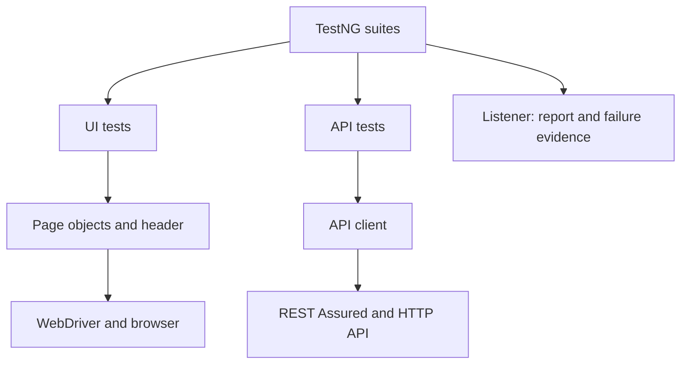

# Selenium Test Automation Framework

A Java 17 portfolio framework for SauceDemo browser testing and JSONPlaceholder API testing. It demonstrates independent tests, reusable page objects, JSON data, failure evidence, reporting and CI integration.

**Validation status:** source and configuration checks were performed, but the complete Maven build and live suites could not run in the delivery environment. Maven and local browsers were unavailable, and the dependency download attempt timed out. See [VALIDATION.md](docs/VALIDATION.md). There is no claimed pass rate or invented execution report.

## Objective and features

- 42 planned business invocations: 35 UI and 7 API, counting data-provider rows.
- Fresh Chrome, Firefox or Edge browser per UI invocation; configurable headless execution.
- Page Object Model with one shared header component and explicit waits.
- TestNG smoke, regression, login, checkout, UI and API groups.
- JSON login, product, customer, sorting and API payload data.
- Thread-local drivers and optional method-level parallel execution.
- Extent Spark HTML reports, failure screenshots and SLF4J/Logback logs.
- GET, POST, PUT and DELETE through a reusable REST Assured client.
- Eleven planned browser-free framework-check invocations plus three browser isolation checks and one explicit intentional-failure diagnostic.
- GitHub Actions workflow with report and failure-image artifacts.

This is a test project. It does not contain the SauceDemo application, real payment processing, a database, AI scoring, production deployment or a Selenium Grid server.

## Stack

| Tool | Pinned version | Purpose |
| --- | --- | --- |
| Java | 17 | Language and runtime baseline |
| Selenium | 4.50.0 | Browser automation; built-in Selenium Manager |
| TestNG | 7.11.0 | Lifecycle, assertions, groups, providers, listeners |
| Maven | 3.9.x recommended | Build and dependency management |
| Maven Compiler / Surefire | 3.14.0 / 3.5.4 | Compile Java 17 and execute TestNG |
| REST Assured | 6.0.1 | HTTP requests and JSON responses |
| Gson | 2.13.2 | Read test data and serialize request bodies |
| Extent Reports | 5.1.2 | Spark HTML report |
| SLF4J / Logback | 2.0.17 / 1.5.18 | Logging facade and implementation |

Versions are pinned rather than floating. Dependency resolution and transitive compatibility still require a Maven run. Extent Reports has been sunset upstream; it is retained to match the requested portfolio stack. Reporting is isolated in two classes so a maintained reporter can replace it later. No claim is made that every pinned dependency is the newest release.

## Architecture



Both layers use configuration, JSON data, TestNG assertions and logging. `BaseTest` provides UI setup/teardown only. API tests do not extend it, so API-only execution never creates a browser. Tests state expectations; pages own locators and user actions; the API client owns request construction. Java records carry immutable test data.

## Project structure

| Path | Contents |
| --- | --- |
| `pom.xml` | Pinned test dependencies and Maven plugins |
| `testng.xml` | Default full regression suite |
| `suites/` | UI, API, smoke, regression, parallel, self-check and diagnostics XML |
| `src/test/java/com/purna/automation/base/` | `BaseTest`, `DriverFactory` |
| `src/test/java/com/purna/automation/pages/` | Login, products, cart, checkout, base page, header |
| `src/test/java/com/purna/automation/tests/` | Five UI test classes |
| `src/test/java/com/purna/automation/api/` | API client, endpoints, API tests |
| `src/test/java/com/purna/automation/utilities/` | Config, waits, JSON, data providers, screenshots |
| `src/test/java/com/purna/automation/listeners/` | Listener and report manager |
| `src/test/java/com/purna/automation/framework/` | Local self-checks and opt-in failure diagnostic |
| `src/test/resources/` | Configuration, logging, eight JSON test-data files |
| `.github/workflows/automation-tests.yml` | CI workflow |
| `reports/`, `screenshots/`, `logs/` | Generated output; ignored by Git |
| `docs/` | Staged build guide, interview answers, resume bullets, validation |

All Java files are under `src/test/java` and dependencies have test scope. This is deliberate: the entire deliverable is an automation test project, not a production application library. There is no empty `src/main` scaffolding. If another repository later consumes the framework as a library, move reusable support into a separate module with appropriate compile dependencies.

## Prerequisites and installation

1. Install a **JDK 17** (not only a JRE), Apache Maven 3.9.x, and Chrome, Firefox or Edge for the selected UI browser.
2. Add Java and Maven `bin` directories to PATH; set `JAVA_HOME` to the JDK folder.
3. Extract the ZIP and open a terminal in `selenium-test-automation-framework`, where `pom.xml` is located.
4. Confirm the tools, then run the local checks and smoke suite:

```bash
java -version
javac -version
mvn -version
mvn -B test -DsuiteXmlFile=suites/self-check.xml
mvn -B test -DsuiteXmlFile=suites/smoke.xml
```

The same Maven commands work in Windows Command Prompt. IntelliJ users can open `pom.xml` as a Maven project and set Project SDK to 17. No Node.js, Express or Flask installation is required.

First execution needs network access to Maven Central, browser-driver download endpoints, SauceDemo and JSONPlaceholder. Selenium Manager resolves compatible drivers automatically. In a restricted corporate environment, use an approved Maven mirror/proxy and an approved matching driver on PATH; do not disable TLS validation to fix connectivity.

There is no Maven wrapper binary in this archive: install Maven explicitly. After dependencies and drivers are cached, the self-check suite can run without the public services; it uses a loopback HTTP server.

## Configuration

Edit `src/test/resources/config.properties`, pass `-Dkey=value`, or set an environment variable. Precedence is **system property > environment variable > selected profile > default file**. Invalid booleans and timeout values fail early.

| Key | Default | Environment variable |
| --- | --- | --- |
| `browser` | `chrome` | `AUTOMATION_BROWSER` |
| `baseUrl` | `https://www.saucedemo.com/` | `AUTOMATION_BASE_URL` |
| `headless` | `true` | `AUTOMATION_HEADLESS` |
| `explicitWait` | `15` seconds | `AUTOMATION_EXPLICIT_WAIT` |
| `pageLoadTimeout` | `45` seconds | `AUTOMATION_PAGE_LOAD_TIMEOUT` |
| `apiBaseUrl` | `https://jsonplaceholder.typicode.com` | `AUTOMATION_API_BASE_URL` |
| `apiConnectTimeoutMs` | `10000` | `AUTOMATION_API_CONNECT_TIMEOUT_MS` |
| `apiReadTimeoutMs` | `20000` | `AUTOMATION_API_READ_TIMEOUT_MS` |
| `apiMaxResponseTimeMs` | `0` (disabled) | `AUTOMATION_API_MAX_RESPONSE_TIME_MS` |

Example Windows Command Prompt:

```bat
set AUTOMATION_BROWSER=chrome
set AUTOMATION_HEADLESS=false
mvn test -DsuiteXmlFile=suites/smoke.xml
```

Example PowerShell:

```powershell
$env:AUTOMATION_HEADLESS="false"
mvn test "-DsuiteXmlFile=suites/ui.xml"
```

Demo credentials in `loginData.json` are intentionally public SauceDemo examples. For real applications, replace that fixture loading with a credential provider backed by environment variables or a secret manager. `ConfigReader.get("username")` would resolve `AUTOMATION_USERNAME` if the calling code requested it; the current demo login helper reads the public JSON fixture. Never put real passwords, tokens or API keys in JSON, Git, console output or data-provider `toString()` methods. CI credentials would come from GitHub Actions secrets. The current public API requires no authentication.

## Running suites

Run from the project root:

| Goal | Command | Planned business invocations |
| --- | --- | --- |
| Everything | `mvn test` | 42 |
| UI only | `mvn test -DsuiteXmlFile=suites/ui.xml` | 35 |
| API only | `mvn test -DsuiteXmlFile=suites/api.xml` | 7 |
| Smoke | `mvn test -DsuiteXmlFile=suites/smoke.xml` | 5 |
| Regression | `mvn test -DsuiteXmlFile=suites/regression.xml` | 42 |
| Optional parallel run | `mvn test -DsuiteXmlFile=suites/parallel.xml` | 42 |
| Login group | `mvn test -Dgroups=login` | 8 |
| Checkout group | `mvn test -Dgroups=checkout` | 9 |
| Local framework checks | `mvn test -DsuiteXmlFile=suites/self-check.xml` | 11 framework checks |

Counts describe implemented provider-expanded cases, not observed results. Smoke includes valid login, add-to-cart, checkout completion and GET post. The regression suite selects all business tests; `RegressionTest` adds one independent end-to-end journey, not calls to other test methods. Avoid combining a restrictive XML group filter with an unrelated `-Dgroups` filter.

Visible browser and Firefox examples:

```bash
mvn test -DsuiteXmlFile=suites/smoke.xml -Dheadless=false
mvn test -DsuiteXmlFile=suites/ui.xml -Dbrowser=firefox -Dheadless=true
```

To apply an optional broad API latency check:

```bash
mvn test -DsuiteXmlFile=suites/api.xml -DapiMaxResponseTimeMs=15000
```

This is a functional smoke budget, not load testing, an SLA measurement or a performance claim. A public demo API can fluctuate.

## Data-driven testing and waits

`TestDataUtils` loads records from JSON and supplies five invalid-login rows, three missing-field rows and four sort rows. The valid-login fixture is also reused for UI setup. Expected product prices are stored independently of the UI; price arithmetic uses `BigDecimal`.

`WaitUtils` uses `WebDriverWait`, an explicit wait built on `FluentWait`, with a 200 ms polling interval. It waits for actual visibility, clickability or state changes and tolerates transient stale references during polling. Implicit wait is zero. There are no arbitrary sleeps and no unconditional retry: business failures use the configurable bounded policy. A wait stops as soon as its condition succeeds; a sleep always consumes the entire delay and may still be too short.

## Parallel execution

Default execution is sequential. `suites/parallel.xml` opts into `parallel="methods"` with three worker threads. Each invocation creates its browser in `@BeforeMethod` and quits it in `@AfterMethod(alwaysRun=true)`. `ThreadLocal.remove()` runs in a `finally` block. Tests keep pages and data in local variables, not mutable shared test fields. Each API call creates a fresh request specification. Report nodes are stored on their own `ITestResult` and screenshots use UUID filenames.

Data providers are intentionally sequential within a method by default. Parallel provider execution can be considered later after measuring resources. Thread-local browsers do not isolate server-side state in a real shared account; unique accounts/data or cleanup would be needed there. SauceDemo carts are session-local and JSONPlaceholder writes are simulated.

## API behavior and boundaries

The seven provider-expanded API invocations exercise JSONPlaceholder independently of SauceDemo. They do not create SauceDemo products or seed its UI. POST/PUT/DELETE return simulated responses; mutations do not persist on the service. Consequently tests assert the response contract, never a subsequent GET of a created record or a real database change. API tests check statuses, JSON fields, Content-Type and optionally a response-time budget. Authentication, schema files and persistent CRUD verification are future extensions.

## Reports, screenshots and logging

Reporting runs automatically through the suite listener; no separate report-generation command is needed.

| Output | Location | Meaning |
| --- | --- | --- |
| Extent HTML | `reports/<UTC-timestamp-UUID>/index.html` | Names, classes, groups, status, timing, failures, images |
| PNG evidence | `screenshots/<run-id>/<class.method>-<UUID>.png` | UI failure screenshot when a browser exists |
| Maven/TestNG output | `target/surefire-reports/` | Machine-readable test execution details |
| Logs | `logs/automation.log` | Browser, navigation, test and API lifecycle events |

Open the newest HTML report after a run. Screenshots are embedded as Base64 and also saved as PNG, so moving the HTML does not break image paths. Spark styling/scripts may require access to its asset CDN. Generated output is not committed.

`IInvokedMethodListener.afterInvocation` captures test/setup failure evidence while the browser is still alive. `ITestListener` records outcomes; configuration failures get their own report node. `IExecutionListener.onExecutionFinish` flushes the report once. API-only failures have no browser screenshot. If startup itself fails before a browser exists, the original failure is reported without an image. Screenshot errors never replace the test's original exception. Teardown errors are configuration failures, and a driver already closed cannot be photographed.

### Generate a real failure screenshot/report example

```bash
mvn test -DsuiteXmlFile=suites/diagnostics.xml
```

**This command intentionally exits nonzero.** It opens a small local HTML page in the browser and raises an intentional assertion failure. Verify a PNG under `screenshots/`, an embedded image on the failed report entry, and that the browser quits. This diagnostic is excluded from every normal suite and from CI regression. It still needs an installed browser and driver. No fabricated PASS report or application screenshot is bundled.

Log events omit passwords and request/response bodies. Before using this framework with real data, review report exceptions and screenshots for sensitive application content and restrict artifact access accordingly.

## GitHub Actions and Git

The workflow runs on pushes to `main`/`master`, pull requests, and manual dispatch. It checks out code, selects JDK 17, caches Maven dependencies, verifies the browser, runs local checks and then headless regression. Maven resolves dependencies during execution. Reports/logs upload even when tests fail; PNG artifacts upload on failure. Normal Maven failures fail the job; no `continue-on-error` hides them. This is a CI test gate and does not deploy an application.

Start a new Git repository locally if needed:

```bash
git init
git add .
git commit -m "Add UI and API test automation framework"
git branch -M main
```

Create your GitHub repository, use its actual URL with `git remote add origin`, and push `main`. Upload the extracted project contents with `.github/` at the repository root, not the ZIP or an extra parent folder. This archive does not create or publish a repository for you. For a production repository, review action updates and consider pinning reviewed action commits.

## Test case matrix

No status column is populated because the live suites were not executed here.

| Test ID | Scenario | Expected result | Test type | Implementation |
| --- | --- | --- | --- | --- |
| TC001 | Valid login | Products page appears | Positive UI | LoginTest.validLogin |
| TC002 | Invalid username | Exact credential error; login form remains | Negative UI | LoginTest.rejectedLogin |
| TC003 | Invalid password | Exact credential error; login form remains | Negative UI | LoginTest.rejectedLogin |
| TC004 | Locked-out user | Locked-out error appears | Negative UI | LoginTest.rejectedLogin |
| TC005 | Empty username | Username-required error appears | Validation UI | LoginTest.rejectedLogin |
| TC006 | Empty password | Password-required error appears | Validation UI | LoginTest.rejectedLogin |
| TC007 | Logout | Login form appears | Positive UI | LoginTest.logout |
| TC008 | Products page | Products heading and six items | Positive UI | ProductsTest.productsPage |
| TC009 | Product names | All six expected names match | Data UI | ProductsTest.productNames |
| TC010 | Product prices | Name-to-price mapping matches JSON | Data UI | ProductsTest.productPrices |
| TC011 | Sort A to Z | Names are ascending | Positive UI | ProductsTest.productSorting |
| TC012 | Sort Z to A | Names are descending | Positive UI | ProductsTest.productSorting |
| TC013 | Sort low to high | Prices are ascending | Positive UI | ProductsTest.productSorting |
| TC014 | Sort high to low | Prices are descending | Positive UI | ProductsTest.productSorting |
| TC015 | Add product | Cart badge changes from zero to one | Positive UI | ProductsTest.addProduct |
| TC016 | Cart contents | Two names, prices, quantities and badge match | Positive UI | CartTest.cartContents |
| TC017 | Remove one item | Other item remains; badge becomes one | Positive UI | CartTest.removeOneProduct |
| TC018 | Remove last item | Cart is empty; badge count is zero | Boundary UI | CartTest.emptyCart |
| TC019 | Continue shopping | Products shown; cart selection preserved | Positive UI | CartTest.continueShopping |
| TC020 | Customer information | Overview contains selected item and subtotal | Positive UI | CheckoutTest.customerInformation |
| TC021 | Missing first name | First-name-required error | Validation UI | CheckoutTest.requiredFields |
| TC022 | Missing last name | Last-name-required error | Validation UI | CheckoutTest.requiredFields |
| TC023 | Missing postal code | Postal-code-required error | Validation UI | CheckoutTest.requiredFields |
| TC024 | Checkout total | Total equals subtotal plus displayed nonnegative tax | Calculation UI | CheckoutTest.checkoutTotal |
| TC025 | Complete order | Thank-you message; cart clears | Positive UI | CheckoutTest.completeCheckout |
| TC026 | Multi-product journey | Items and totals match; purchase completes; logout succeeds | End-to-end UI | RegressionTest.multiProductPurchase |
| TC027 | GET /posts/1 | 200, JSON, known IDs and nonempty title/body | Positive API | ApiTest.getPost |
| TC028 | GET /posts | 200, JSON, nonempty collection with unique IDs | Positive API | ApiTest.listPosts |
| TC029 | GET missing post | 404 and empty JSON object | Negative API | ApiTest.missingPost |
| TC030 | POST /posts | 201, echoed fields and positive generated ID | Positive API | ApiTest.createPost |
| TC031 | PUT /posts/1 | 200, updated fields and matching ID | Positive API | ApiTest.updatePost |
| TC032 | DELETE /posts/1 | 200 and empty JSON object | Positive API | ApiTest.deletePost |

## Troubleshooting

| Symptom | What to check |
| --- | --- |
| `mvn` not recognized | Install Maven, fix PATH, reopen terminal, run `mvn -version` |
| Compiler/JDK error | Use JDK 17; inspect `JAVA_HOME`, `javac -version` and `mvn -version` |
| Dependency download fails | Maven Central access, approved proxy/mirror, network connectivity |
| Browser cannot start | Browser installation, matching driver resolution, permissions, Selenium logs |
| Element timeout | Inspect screenshot and page state; confirm selector/application changes before raising waits |
| API-only unexpectedly launches Chrome | Use `suites/api.xml`; API tests must not extend `BaseTest` |
| No screenshots | Images are failure-only; API failures and failed driver startup have no browser |
| No HTML report | Run a suite XML with the listener; compilation failures occur before listeners start |
| Empty or unexpected test selection | Check the selected XML and any `-Dgroups` filter |
| Public API error/slow response | Inspect status/logs; distinguish service/network failures from a contract bug |
| Report looks unstyled | Allow report asset CDN or inspect Surefire output; screenshots remain embedded |

## How to explain this project in an interview

“I built a Java automation framework for SauceDemo UI workflows and a separate public demo API. Selenium page objects encapsulate locators and actions, while TestNG tests hold assertions. A common base creates a new browser for each UI test. JSON files drive negative login, field validation and sorting cases. The API client uses REST Assured for GET, POST, PUT and DELETE. Both layers share configuration, logging and an Extent report listener. On a UI failure, the listener captures a screenshot before teardown. Optional parallel execution uses thread-local drivers and separate report entries. GitHub Actions is configured to run the suites headlessly and upload evidence. My next step is to complete a full Maven and live-browser run and inspect the results; I do not claim an unmeasured pass rate or time saving.”

After you run it yourself, replace the validation sentence with your actual observed result. Read [INTERVIEW_GUIDE.md](docs/INTERVIEW_GUIDE.md) for a one-minute pitch, two-minute pitch, 30 implementation-specific questions.

## Future improvements

- Validate on your own machine and CI; retain real evidence before claiming results.
- Migrate from sunset Extent Reports after evaluating a maintained reporting tool.
- Add a browser CI matrix or Selenium Grid when more browser coverage is justified.
- Add API authentication, schema checks and persistent-resource cleanup against an owned test API.
- Add accessibility checks, real tax-rule expectations and additional checkout boundary cases.
- Introduce a dependency-update process and review transitive changes.
- Measure runtime and flakiness before changing the bounded retry policy; preserve original failures.

## Learning materials

- [BUILD_STAGES.md](docs/BUILD_STAGES.md): incremental changes, reasons and validation boundaries.
- [INTERVIEW_GUIDE.md](docs/INTERVIEW_GUIDE.md): explanations and 30 answered questions.
- [RESUME_BULLETS.md](docs/RESUME_BULLETS.md): three runtime-validated component bullets.
- [VALIDATION.md](docs/VALIDATION.md): checks performed, blockers and run checklist.
- [Official sources](docs/SOURCES.md): upstream documentation used for design.


## Upgrade configuration and commands (PowerShell)

Run commands from the directory containing `pom.xml`. For the path in your terminal:

```powershell
Set-Location "C:\Users\madhu\Downloads\Selenium_Test_Automation_Framework\selenium-test-automation-framework"
Get-Item pom.xml
mvn clean test
mvn test "-DsuiteXmlFile=suites/smoke.xml"
mvn test "-DsuiteXmlFile=suites/regression.xml"
mvn test "-DsuiteXmlFile=suites/ui.xml"
mvn test "-DsuiteXmlFile=suites/api.xml"
mvn test "-DsuiteXmlFile=suites/parallel.xml"
mvn test "-DsuiteXmlFile=suites/self-check.xml"
mvn test "-DsuiteXmlFile=suites/browser-self-check.xml"
mvn test "-DsuiteXmlFile=suites/diagnostics.xml"
mvn test "-DsuiteXmlFile=suites/smoke.xml" "-Dbrowser=chrome"
mvn test "-DsuiteXmlFile=suites/smoke.xml" "-Dbrowser=firefox"
mvn test "-DsuiteXmlFile=suites/smoke.xml" "-Dbrowser=edge"
mvn test "-DsuiteXmlFile=suites/smoke.xml" "-Dheadless=true" "-Denv=qa"
mvn test "-DsuiteXmlFile=suites/regression.xml" "-DmaxRetries=0"
```

Adjust the extraction path to the actual updated archive location. Quoting the whole `-D...` argument prevents PowerShell splitting; the previous missing-POM error came from running in `C:\Users\madhu`. Bash accepts these quoted arguments too.

Configuration precedence is JVM property > AUTOMATION environment variable > selected profile > default file. Select local, qa or stage with `-Denv=qa` / `AUTOMATION_ENV`. Examples: `AUTOMATION_BROWSER`, `AUTOMATION_HEADLESS`, `AUTOMATION_EXPLICIT_WAIT`, `AUTOMATION_MAX_RETRIES`. QA and stage use longer waits but still point at the same public demos: they are not separate deployed applications. SauceDemo passwords are public demo fixtures; replace targets and inject real secrets before adapting this project to private systems.

Default maxRetries=1 means one additional attempt per failed business case. Zero disables retries. Framework checks, genuine skips and the intentional diagnostic are excluded. Reports retain each failed attempt, label recovered cases flaky and write `attempt-summary.json`; a recovered test is not evidence that the first attempt worked. Concurrent duplicate rows with identical parameter values share a budget; current providers use distinct case IDs.

Screenshots have unique timestamp/UUID filenames, embedded report images and JSON metadata sidecars. URLs omit userinfo, query and fragment values; unknown paths are omitted. API traces retain method/status/timing/content-type and bounded JSON structure, omit headers/cookies and all payload values. Exception classes and stack locations are retained while exception messages are deliberately omitted because assertion/network messages can contain credentials or payloads. Inspect the original assertion and local Surefire results for detailed debugging; Surefire is a separate output and may contain test values. Browser images can show on-screen information and need access controls for private applications.

The browser self-check creates three simultaneous real sessions against a local data page and validates driver isolation plus wait helpers. The diagnostic deliberately fails: a nonzero Maven exit is expected only after reviewing its screenshot/report/cleanup checks. Neither suite ran in this delivery environment. The browser-free self-check includes controlled nested retry fixtures whose intentional inner failures are asserted by the outer check.

CI accepts smoke/regression, browser and profile inputs, checks browser availability, compiles, runs both framework suites, then the business suite headlessly. It uploads evidence even after recovered failures. Hosted execution has not been validated. See PROJECT_REVIEW, CHANGES, BUILD_STAGES and VALIDATION in docs for the inspection, exact edits and actual results.

Added data rows: TC033 performance-glitch user login; TC034–039 individual catalog product/cart checks; TC040–041 additional synthetic-customer checkout; TC042 second POST payload. The smoke suite now selects five invocations. Counts describe selection, not successful execution.
"# Selenium_Test_Automation_Framework" 
